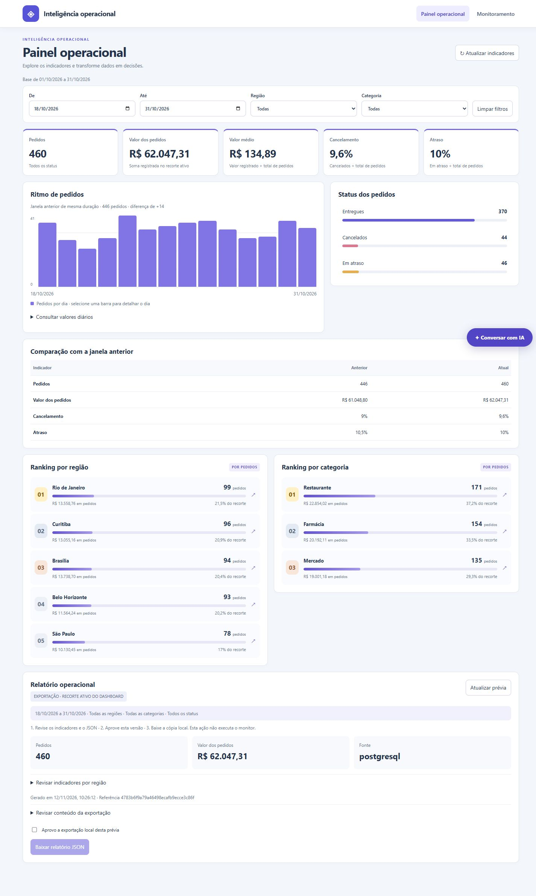
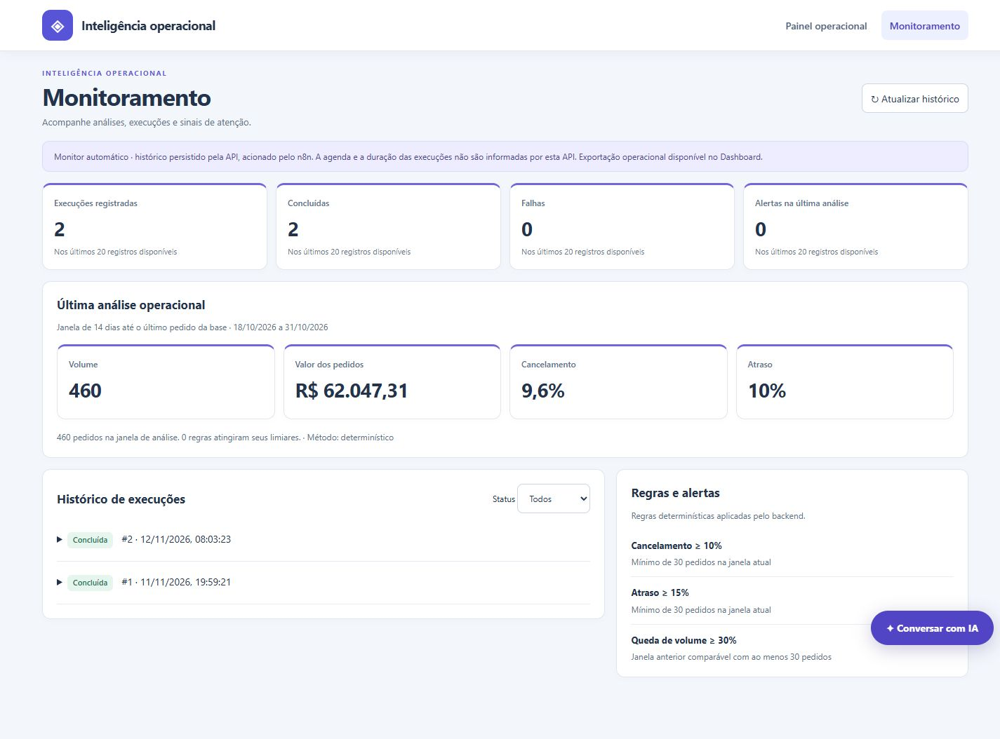
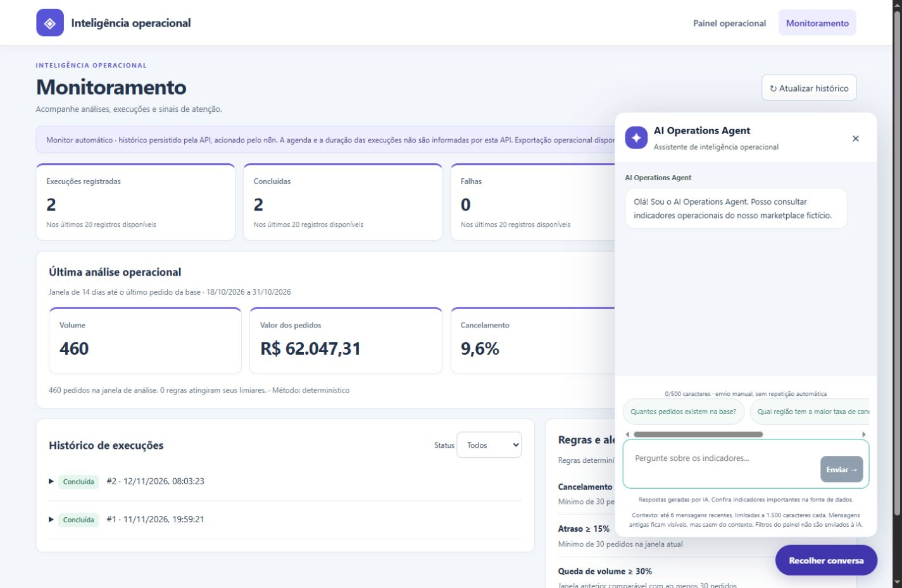
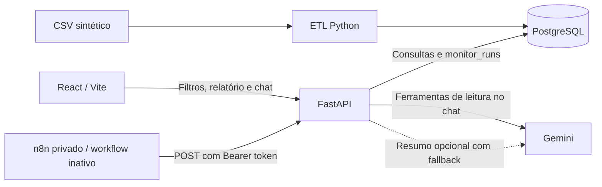

# Agente de Inteligência Operacional

Aplicação de portfólio que reúne **BI interativo, consultas com Gemini e monitoramento com n8n** para analisar pedidos de um marketplace fictício. O objetivo é facilitar a investigação de volume, cancelamento e atraso por período, região, categoria e status.

**Estado:** demonstração local validada; hospedagem 24/7 ainda pendente. A base contém **1.000 pedidos sintéticos de outubro de 2026**, cinco regiões e três categorias. **Valor dos pedidos não é receita:** inclui todos os status do recorte, inclusive cancelados.



## O que este projeto demonstra

| Necessidade de negócio | Implementação | Evidência técnica |
| --- | --- | --- |
| Investigar variações na operação | Filtros combináveis e comparação com período anterior | Agregações PostgreSQL, série diária e rankings clicáveis |
| Compartilhar um recorte revisado | Prévia e exportação JSON vinculadas aos filtros | Aprovação invalidada quando o recorte muda; `scope` no arquivo |
| Identificar sinais de atenção | Regras de cancelamento, atraso e queda de volume | Análise determinística e histórico persistido em `monitor_runs` |
| Consultar dados em linguagem natural | Chat flutuante nas duas abas | Gemini com ferramentas autorizadas de leitura e contexto limitado |

O trabalho conecta modelagem de indicadores, API, integração de serviços, interface responsiva e testes. Não há medição de redução de custos, ganho de produtividade ou resultado financeiro de uma operação real.

## Funcionalidades e telas reais

### Painel operacional

- Pedidos, valor dos pedidos, valor médio, cancelamento e atraso.
- Datas, região e categoria aplicadas automaticamente, sem botão Aplicar. Status, dias e rankings também filtram; seleções se combinam e podem ser removidas.
- Atualização suave dos resultados, mantendo o painel durante a consulta; estados de erro, carregamento e ausência de pedidos.
- Comparação com a janela imediatamente anterior de igual duração e mesmos filtros, quando há cobertura completa.
- Prévia e JSON com o mesmo recorte, inclusive nos 14 dias iniciais; download após aprovação da versão. O seletor de status apresenta os três status sob os demais filtros para permitir alternar a seleção.
- Cabeçalho fixo, navegação por teclado, tabela dos valores diários e layout para desktop e celular.

[Captura mobile](docs/evidence/painel-mobile.jpg) · [Recorte combinado](docs/evidence/filtros-atuais.jpg)

### Monitoramento



O n8n aciona a API, que aplica as regras e registra o resultado. A tela permite consultar até 20 registros de `monitor_runs`, filtrar status e inspecionar relatórios. Atualizar a tela apenas relê os dados; não dispara o monitor.

| Regra | Limiar da demonstração |
| --- | --- |
| Cancelamento | ≥ 10%, com ao menos 30 pedidos na janela |
| Atraso | ≥ 15%, com ao menos 30 pedidos na janela |
| Queda de volume | ≥ 30%, com janela anterior completa e ao menos 30 pedidos anteriores |

A janela compreende 14 dias até o último pedido da base. Há no máximo um sucesso por dia de São Paulo, inclusive com chamadas simultâneas. Falhas são persistidas quando o banco está disponível; falhas anteriores à API podem aparecer apenas no n8n. O workflow distribuído está inativo, com execução manual e agenda configurada para 09h de São Paulo. **Não há envio externo de notificações.** O resumo Gemini do monitor é opcional e tem fallback determinístico.

### Assistente de dados



O chat está disponível em **Painel operacional** e **Monitoramento**. Envia a pergunta a `POST /agent/chat`, mantém a conversa na sessão da página e usa até seis mensagens recentes, com limites de tamanho. Recarregar limpa a sessão. Os filtros do painel não são enviados implicitamente ao assistente. As ferramentas consultam dados; não executam SQL arbitrário nem alterações operacionais.

A captura mostra a interface real; não representa uma nova validação de resposta do provedor. Uma consulta real anterior confirmou 1.000 pedidos, mas a tentativa de continuação encontrou indisponibilidade. O contexto foi validado por testes de contrato e SDK; não se afirma sucesso de continuação no Gemini real.

## Arquitetura e stack



| Camada | Tecnologias e responsabilidade |
| --- | --- |
| Interface | React 19, Vite 8, CSS; gráficos e interações da aplicação |
| API e dados | Python, FastAPI, Pydantic, psycopg, PostgreSQL 17 |
| IA | Google Gen AI SDK; `GEMINI_MODEL` configurável |
| Automação | n8n, repetição controlada e persistência pela API |
| Qualidade e execução | pytest, Oxlint, build Vite, GitHub Actions; PowerShell local e Compose opcional |

Dependências Python estão fixadas em [requirements.txt](requirements.txt); o frontend possui [package-lock.json](frontend/package-lock.json). As rotas principais são `GET /operations/dashboard`, `GET /reports/operations`, `GET /operations/monitor/runs`, `POST /operations/monitor/run` e `POST /agent/chat`. A API local documenta os contratos em [Swagger](http://127.0.0.1:8000/docs), acessível após iniciar os serviços.

## Executar localmente no Windows

Pré-requisitos: Git, Python 3.12, PostgreSQL 17 iniciado e Node 24 com npm. O script atual localiza o Node nas instalações do **Author Software NVM** e o n8n nessa mesma instalação; veja a alternativa manual em [instalação local](docs/SETUP.md).

```powershell
git clone https://github.com/GabrielTIAlef/agente_inteligencia_operacional.git
cd agente_inteligencia_operacional
py -3.12 -m venv .venv
.\.venv\Scripts\python.exe -m pip install -r requirements-dev.txt
Copy-Item .env.example .env
```

Crie um banco vazio dedicado à demonstração no PostgreSQL. Edite `.env` com os dados de conexão e um `MONITOR_TOKEN` próprio. Configure `GEMINI_API_KEY` somente para usar a IA; painel e regras determinísticas não precisam dela. **Em uma instalação n8n existente, preserve a chave de criptografia original.** Não sobrescreva o `.env` de uma instalação existente.

```powershell
cd frontend
npm ci
cd ..
# Apenas se o n8n ainda não estiver instalado nessa versão do Node:
npm install -g n8n@2.6.4
.\deploy\start-local.ps1
```

O início aplica o schema e carrega o CSV apenas se a tabela de pedidos estiver vazia. Não substitui processos que ocupem as portas e não ativa workflows.

| Serviço | Endereço local |
| --- | --- |
| Aplicação | http://127.0.0.1:5173 |
| API / saúde | http://127.0.0.1:8000/health |
| Editor n8n | http://127.0.0.1:5678 |

Para importar o workflow, selecionar a credencial Header Auth e usar Compose opcionalmente, siga [SETUP.md](docs/SETUP.md). A versão n8n indicada reproduz o exemplo; sua segurança e compatibilidade devem ser revistas antes de qualquer implantação remota.

## Testes e evidências

Reexecutado em **12/11/2026** no ambiente Windows com PostgreSQL local:

| Verificação | Resultado |
| --- | --- |
| pytest com `RUN_DB_TESTS=1` | **56 aprovados**; inclui PostgreSQL com tabelas temporárias e rollback |
| `npm run lint` | Aprovado |
| `npm run build` | Aprovado |

```powershell
$env:RUN_DB_TESTS='1'
.\.venv\Scripts\python.exe -m pytest -q -p no:cacheprovider
cd frontend
npm run lint
npm run build
```

Sem `RUN_DB_TESTS=1`, os testes de integração com banco podem ser ignorados. A suíte usa o banco configurado em `.env`; utilize uma instância dedicada de desenvolvimento. Os testes não medem disponibilidade 24/7 nem fazem uma validação completa do Gemini real.

As capturas são da aplicação local atual com API e PostgreSQL reais e dados sintéticos. Consulte [evidências e escopo](docs/VALIDATION.md) e o [histórico de Actions](https://github.com/GabrielTIAlef/agente_inteligencia_operacional/actions). O resultado local não substitui o resultado remoto do CI.

## Limitações e próximos passos

- A base não contém pagamentos, repasses, margens, prazo prometido ou data de entrega; não permite calcular receita reconhecida, lucro ou SLA logístico.
- O histórico do painel não é a telemetria completa do n8n: não informa duração, execução em andamento ou agenda ativa.
- Gemini depende de disponibilidade e cota; o controle de uso atual é local e por processo. Autenticação e limite persistente ainda são necessários para acesso público.
- Não há hospedagem, domínio público, garantia de disponibilidade, notificações externas ou integração com pedidos reais.

O plano de implantação inclui HTTPS, controle de acesso, contas de banco com privilégio mínimo, backups com restauração testada, reinício automático e observabilidade. Veja [implantação](docs/DEPLOYMENT.md) e [roadmap](docs/ROADMAP.md). A agenda só deve ser ativada após validação e autorização específica.

## Documentação e manutenção

- [Instalação e configuração](docs/SETUP.md)
- [Validação atual e capturas](docs/VALIDATION.md)
- [Histórico de validação local](docs/LOCAL-READINESS.md)
- [Entrega e contratos do frontend](docs/FRONTEND-DELIVERY.md)
- [Implantação futura](docs/DEPLOYMENT.md) · [Roadmap](docs/ROADMAP.md)

Mantido por [GabrielTIAlef](https://github.com/GabrielTIAlef). Sugestões e problemas sem credenciais ou dados pessoais podem ser registrados em [Issues](https://github.com/GabrielTIAlef/agente_inteligencia_operacional/issues).
