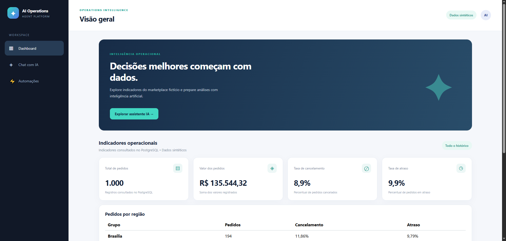
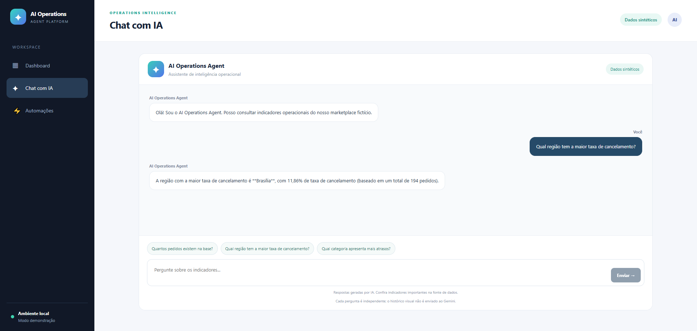
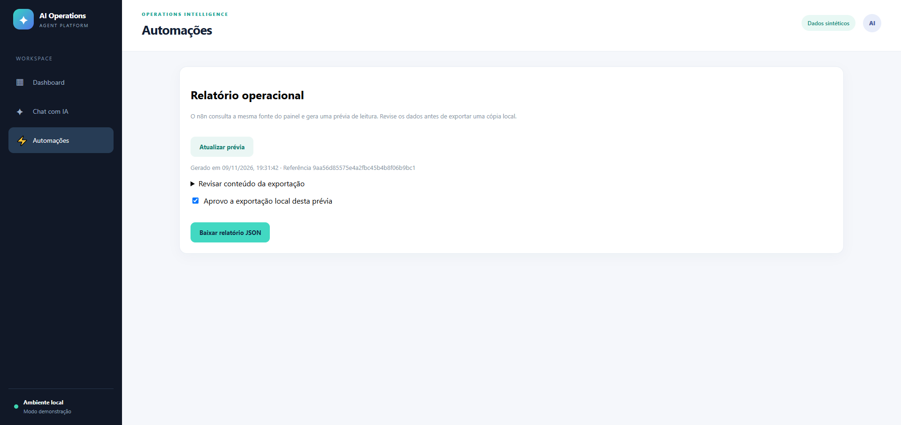
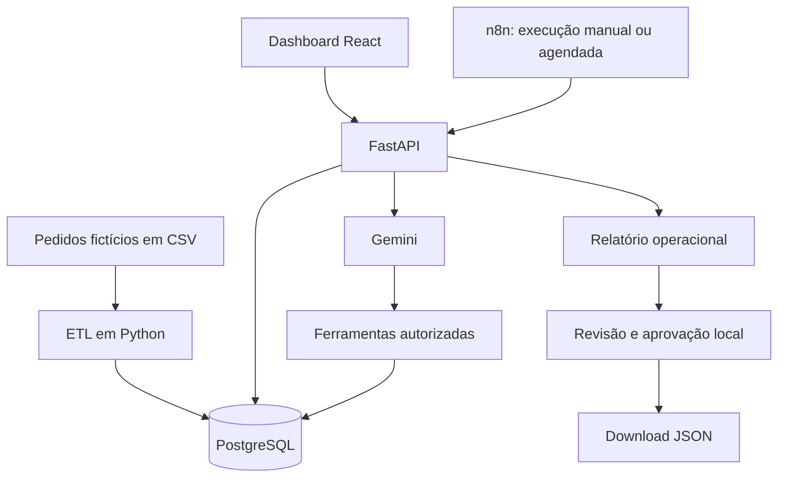

# Agente de Inteligência Operacional

Plataforma de inteligência operacional desenvolvida com **Python, PostgreSQL, FastAPI, React, Gemini e n8n**, integrando Engenharia de Dados, Business Intelligence, Inteligência Artificial Generativa e automação de processos.

A aplicação utiliza dados sintéticos de um marketplace de entregas para consolidar indicadores, disponibilizar análises operacionais, responder a perguntas em linguagem natural e gerar relatórios estruturados.

> **Escopo:** projeto demonstrativo com dados inteiramente fictícios. Não representa uma operação real nem utiliza informações de clientes ou empresas.

## Contexto e problema de negócio

Marketplaces e plataformas de entregas precisam acompanhar continuamente o desempenho de suas operações, incluindo volume de pedidos, cancelamentos, atrasos e diferenças entre regiões e categorias.

Embora essas informações possam estar armazenadas em bancos de dados, transformá-las em indicadores úteis pode exigir consultas SQL, consolidação manual de resultados e elaboração recorrente de relatórios.

A proposta deste projeto surgiu da necessidade de demonstrar como uma arquitetura integrada de dados e inteligência artificial pode tornar essas informações mais acessíveis e padronizar seu acompanhamento.

### Desafios abordados

| Desafio | Problema operacional |
| --- | --- |
| Centralização de dados | Registros precisam ser organizados em uma base consistente para análise. |
| Acesso aos indicadores | Consultas podem depender de conhecimento técnico em SQL. |
| Monitoramento operacional | Cancelamentos e atrasos precisam ser comparados entre diferentes segmentos. |
| Geração de relatórios | A elaboração recorrente de resumos pode exigir atividades manuais. |
| Rastreabilidade da IA | Respostas precisam estar vinculadas a consultas verificáveis e permitir investigação de falhas. |

O cenário foi construído exclusivamente para demonstração técnica. Os problemas descritos representam necessidades plausíveis de uma operação de marketplace, e não dificuldades medidas em uma empresa específica.

## Solução desenvolvida

Foi construída uma plataforma que integra armazenamento relacional, processamento de dados, API, interface web, inteligência artificial generativa e automação.

A solução possui cinco componentes principais.

### 1. Engenharia de Dados e PostgreSQL

Um pipeline ETL em Python valida registros sintéticos de pedidos e realiza sua carga no PostgreSQL.

A implementação contempla:

- Validação de identificadores, tipos, datas, valores e status.
- Persistência relacional com esquema SQL versionado.
- Inserção e atualização de registros por identificador, utilizando UPSERT.
- Processamento transacional para evitar cargas parcialmente confirmadas.
- Consultas analíticas para consolidação dos indicadores operacionais.

### 2. Dashboard operacional

Uma aplicação React consome a FastAPI para apresentar indicadores e análises agrupadas.

O painel disponibiliza:

- Total de pedidos registrados.
- Soma dos valores dos pedidos.
- Taxa de cancelamento.
- Taxa de atraso.
- Análises por região.
- Análises por categoria.

Os indicadores são calculados a partir dos registros da demonstração e disponibilizados por endpoints da API.

### 3. Agente de inteligência artificial

O agente utiliza Gemini para interpretar perguntas em linguagem natural e solicitar consultas previamente autorizadas.

O processo de resposta utiliza **Function Calling**, permitindo que o modelo escolha ferramentas definidas no backend.

As ferramentas consultam métricas operacionais por meio de SQL. O modelo não recebe acesso irrestrito ao PostgreSQL nem permissão para executar comandos SQL arbitrários.

### 4. Automação de relatórios com n8n

Um workflow n8n consulta a FastAPI para obter uma representação estruturada dos indicadores.

O fluxo oferece:

- Gatilho de execução manual.
- Gatilho de agendamento diário.
- Requisição HTTP ao endpoint de relatórios.
- Recebimento dos indicadores e agrupamentos.
- Histórico de tentativas e execuções na instância n8n.

O agendamento foi configurado para 09h, no horário de São Paulo, mas permanece inativo na configuração de demonstração.

### 5. Segurança e rastreabilidade

A aplicação implementa controles específicos para sua execução local:

- Validação de entradas.
- Limitação do tamanho das requisições.
- Restrição das ferramentas disponibilizadas ao agente.
- Transações de leitura para consultas analíticas.
- Limites para chamadas ao Gemini.
- Identificadores de requisição para rastreamento.
- Tratamento de erros sem exposição deliberada de credenciais.

Esses controles não substituem autenticação, autorização ou outras proteções necessárias em um ambiente produtivo compartilhado.

## Resultados da demonstração

A base de referência contém **1.000 pedidos fictícios**, correspondentes ao período de outubro de 2026.

| Indicador | Resultado |
| --- | ---: |
| Total de pedidos | 1.000 |
| Soma dos valores registrados | R$ 135.544,32 |
| Taxa de cancelamento | 8,9% |
| Taxa de atraso | 9,9% |
| Regiões | 5 |
| Categorias | 3 |

A soma dos valores registrados corresponde aos valores dos pedidos da base demonstrativa. Não deve ser interpretada automaticamente como receita líquida, faturamento reconhecido ou lucro.

### Evidências técnicas

A auditoria local do projeto registrou:

- **40 testes Python aprovados.**
- Verificação de lint do frontend concluída.
- Build do frontend concluído.
- Consultas operacionais ao PostgreSQL executadas.
- Endpoint de relatórios retornando dados estruturados.
- Execuções manuais do workflow n8n registradas.
- Comunicação do chat com Gemini validada em ambiente local.

Os resultados comprovam aspectos da implementação demonstrativa, não desempenho em produção ou impacto financeiro real.

## Evidências visuais

As capturas abaixo apresentam a aplicação em execução local com dados fictícios.

### Dashboard de inteligência operacional

O dashboard consolida indicadores e análises para acompanhamento da operação simulada.



### Agente de inteligência artificial

O agente permite formular perguntas em linguagem natural e consultar indicadores por meio das ferramentas autorizadas do backend.



### Automação de relatórios com n8n

O workflow consulta a API para obter indicadores operacionais estruturados, permitindo execução manual e configuração de agendamento.



As imagens documentam o ambiente local da demonstração. A disponibilidade do modelo Gemini depende do serviço externo e dos limites associados à chave utilizada.

## Arquitetura da solução



### Fluxo de funcionamento

**1. Preparação dos dados**

O gerador cria uma base sintética de pedidos. O ETL valida os registros e os carrega no PostgreSQL.

**2. Consolidação dos indicadores**

A FastAPI executa consultas para calcular métricas gerais e agrupamentos por região e categoria.

**3. Consumo pelo dashboard**

O React consulta os endpoints da API e apresenta as informações ao usuário.

**4. Consulta em linguagem natural**

O usuário envia uma pergunta ao agente. O Gemini interpreta a solicitação, pode selecionar uma ferramenta autorizada e utiliza o resultado retornado para formular a resposta.

**5. Automação de relatórios**

O n8n realiza uma requisição HTTP à API e recebe os dados estruturados do relatório operacional.

**6. Revisão e exportação**

A interface permite revisar uma prévia do relatório, aprovar a versão apresentada e baixar o JSON. Uma nova versão exige nova aprovação local.

## Tecnologias utilizadas

| Tecnologia | Aplicação no projeto |
| --- | --- |
| Python | ETL, consultas, regras de negócio e backend. |
| PostgreSQL | Armazenamento relacional e consultas analíticas. |
| SQL | Consolidação dos indicadores e agrupamentos. |
| FastAPI | API REST e integração entre os componentes. |
| React | Interface web e dashboard operacional. |
| Vite | Ambiente de desenvolvimento e build do frontend. |
| Gemini | Interpretação de perguntas e Function Calling. |
| n8n | Orquestração de relatórios por requisição HTTP. |
| Pytest | Testes automatizados do backend. |
| Git e GitHub | Versionamento e publicação do projeto. |

## Estrutura do repositório

```text
agente_inteligencia_operacional/
│
├── app/
│   ├── access.py
│   ├── agent.py
│   ├── agent_api.py
│   ├── analytics.py
│   ├── database.py
│   ├── main.py
│   ├── reports.py
│   └── tools.py
│
├── data/
│   ├── generate_data.py
│   └── synthetic/
│       └── pedidos.csv
│
├── etl/
│   ├── load_orders.py
│   └── schema.sql
│
├── frontend/
│   ├── public/
│   ├── src/
│   ├── package.json
│   └── vite.config.js
│
├── n8n/
│   └── operations-report.json
│
├── docs/
│   └── evidence/
│       ├── dashboard.png
│       ├── agente_ia.png
│       └── automacao_n8n.png
│
├── tests/
├── .env.example
├── .gitignore
├── requirements.txt
├── requirements-dev.txt
└── README.md
```

A estrutura acima resume os principais componentes; arquivos auxiliares permanecem disponíveis no repositório.

## Configuração do ambiente local

### Pré-requisitos

- Python 3.12.
- PostgreSQL.
- Node.js compatível com as versões de Vite e n8n utilizadas.
- npm.
- Chave de API do Gemini para utilizar o agente.
- n8n para executar o workflow de automação.

Os comandos abaixo utilizam Windows PowerShell.

### 1. Clonar o repositório

```powershell
git clone https://github.com/GabrielTIAlef/agente_inteligencia_operacional.git
cd agente_inteligencia_operacional
```

### 2. Criar o ambiente Python

```powershell
py -3.12 -m venv .venv
.\.venv\Scripts\python.exe -m pip install -r requirements-dev.txt
```

### 3. Configurar as variáveis de ambiente

Crie um arquivo `.env` a partir do modelo:

```powershell
Copy-Item .env.example .env
```

Configure localmente as variáveis necessárias:

```dotenv
DB_HOST=127.0.0.1
DB_PORT=5432
DB_NAME=nome_do_banco
DB_USER=usuario_do_banco
DB_PASSWORD=senha_local
GEMINI_API_KEY=sua_chave_local
GEMINI_MODEL=modelo_disponivel
```

Os nomes acima representam as configurações principais. Consulte `.env.example` para as demais opções e valores esperados pela implementação.

O modelo Gemini deve ser escolhido entre os modelos disponíveis para a chave e compatíveis com as funcionalidades utilizadas.

**Nunca publique o arquivo `.env` ou credenciais reais.**

### 4. Preparar o PostgreSQL

Crie um banco dedicado exclusivamente à demonstração sintética.

Aplique o esquema SQL localizado em:

```text
etl/schema.sql
```

A aplicação do esquema pode ser feita por um cliente PostgreSQL ou pelo `psql`, conforme a instalação local.

Não execute a carga em um banco que contenha registros que precisem ser preservados.

### 5. Executar o ETL

Na raiz do projeto:

```powershell
.\.venv\Scripts\python.exe -m etl.load_orders
```

O processo realiza a validação e a carga dos registros sintéticos no banco configurado.

### 6. Iniciar a FastAPI

Em um terminal PowerShell:

```powershell
.\.venv\Scripts\python.exe -m uvicorn app.main:app --host 127.0.0.1 --port 8000 --no-proxy-headers --no-access-log
```

A documentação interativa da API estará disponível em:

http://127.0.0.1:8000/docs

O endpoint de verificação pode ser acessado em:

http://127.0.0.1:8000/health

### 7. Iniciar o frontend React

Em outro terminal:

```powershell
cd frontend
npm ci
npm run dev -- --host 127.0.0.1 --port 5173 --strictPort
```

Acesse:

http://127.0.0.1:5173

O frontend utiliza a API local por padrão. A variável `VITE_API_URL` pode ajustar esse endereço.

Variáveis de ambiente iniciadas por `VITE_` são incorporadas ao frontend e não devem conter segredos.

## Demonstração prática

### Consulta aos indicadores

Abra o dashboard e verifique os indicadores gerais, as regiões e as categorias.

Compare os resultados exibidos com a base de referência.

### Perguntas ao agente de IA

Abra o chat e experimente perguntas como:

- Quantos pedidos existem na base?
- Qual região apresentou a maior taxa de cancelamento?
- Quais categorias possuem mais pedidos?
- Como estão os indicadores operacionais do período?

O agente pode selecionar uma ferramenta previamente autorizada, receber os indicadores do PostgreSQL e produzir uma resposta em linguagem natural.

As respostas devem ser conferidas contra os indicadores calculados. A disponibilidade do provedor externo não é garantida.

### Relatórios operacionais

Na área de automações, visualize a prévia do relatório.

A interface permite:

1. Consultar os indicadores.
2. Revisar o conteúdo da prévia.
3. Aprovar a versão apresentada.
4. Baixar o relatório em JSON.

Uma nova consulta que altere a versão da prévia exige nova aprovação.

A aprovação implementada é local à interface e não representa uma autorização empresarial autenticada.

## Automação com n8n

O arquivo do workflow está disponível em:

```text
n8n/operations-report.json
```

Para executar a automação:

1. Inicie uma instância local do n8n.
2. Importe o arquivo JSON do workflow.
3. Mantenha a FastAPI em execução na porta 8000.
4. Abra o workflow no editor do n8n.
5. Execute o fluxo manualmente.
6. Verifique os resultados do nó HTTP Request.

A requisição utilizada é:

```http
GET http://127.0.0.1:8000/reports/operations
```

O endpoint retorna uma estrutura com identificador da requisição, data de geração, resumo operacional e agrupamentos.

Os campos principais incluem:

```json
{
  "request_id": "...",
  "generated_at": "...",
  "source": "postgresql",
  "summary": {},
  "regions": [],
  "categories": []
}
```

A estrutura acima é ilustrativa.

O gatilho agendado está configurado para execução diária às 09h no horário de São Paulo, mas necessita de ativação na instância n8n.

O fluxo demonstrativo realiza consultas de leitura. Não modifica pedidos nem envia informações automaticamente a serviços externos.

## Segurança, rastreabilidade e limitações

O sistema foi desenvolvido como uma aplicação demonstrativa local, destinada a um único usuário.

### Controles implementados

- Restrições de origem e Host para o ambiente local.
- Validação das entradas da API.
- Limite de 500 caracteres por pergunta ao agente.
- Limite de corpo JSON de 8 KiB para o chat.
- Limitação local de tentativas por minuto.
- Restrição das ferramentas autorizadas.
- Consultas analíticas em transações somente de leitura.
- Limites para chamadas ao modelo.
- Prazo de execução para consultas SQL.
- Identificação das requisições por `request_id`.
- Tratamento de erros sem retornar detalhes internos ao usuário.

Os registros operacionais utilizam identificadores de requisição para correlacionar chamadas à API, ferramentas e falhas do agente.

### Limitações da implementação

A solução não possui autenticação de usuários, autorização individual ou infraestrutura de produção.

Para utilização compartilhada ou implantação empresarial, seriam necessários controles adicionais, incluindo:

- Autenticação e autorização.
- HTTPS.
- Gerenciamento centralizado de segredos.
- Limites distribuídos de requisições.
- Monitoramento e auditoria adequados.
- Configuração de infraestrutura e implantação.
- Separação de permissões entre o usuário do ETL e o runtime da aplicação.

A integração com Gemini depende de um serviço externo e pode apresentar indisponibilidade, limites de cota ou alterações de disponibilidade dos modelos.

## Testes e validação

O projeto inclui testes automatizados do backend e verificações de qualidade do frontend.

### Testes Python

Na raiz do repositório:

```powershell
.\.venv\Scripts\python.exe -B -m pytest -p no:cacheprovider -q
```

A última auditoria técnica registrou **40 testes aprovados**.

### Verificação do frontend

```powershell
cd frontend
npm run lint
npm run build
```

As duas verificações foram concluídas com sucesso na auditoria local.

### Teste de interface

O repositório contém um teste de navegador em:

```text
frontend/tests/demo.mjs
```

O teste utiliza Microsoft Edge e Playwright Core, além dos serviços locais e do PostgreSQL.

A execução exige a preparação do módulo Playwright e a definição de `PLAYWRIGHT_MODULE` com a URL de arquivo correspondente ao `index.mjs`.

Ele verifica aspectos do dashboard e o tratamento visual de uma falha simulada do Gemini.

### Escopo dos testes

Os testes demonstram comportamentos específicos da implementação, incluindo validação, consulta, integração e tratamento de falhas.

Eles não substituem testes de carga, avaliação de segurança para produção ou validação de qualidade das respostas do agente em todos os cenários.

## Decisões de arquitetura

| Decisão | Justificativa |
| --- | --- |
| PostgreSQL como fonte analítica | Centralizar os dados e permitir consultas reproduzíveis. |
| FastAPI entre interface e banco | Separar a apresentação das regras e do acesso aos dados. |
| Function Calling | Restringir a IA a operações previamente implementadas. |
| SQL no backend | Evitar a execução de consultas arbitrárias criadas pelo modelo. |
| n8n para automação | Separar a orquestração de relatórios da aplicação web. |
| Identificador de requisição | Facilitar a investigação de falhas e o acompanhamento das operações. |
| Dados sintéticos | Permitir demonstração sem depender de informações empresariais. |

## Possíveis evoluções

A arquitetura permite considerar futuras melhorias, como:

- Autenticação e controle de acesso por usuário.
- Histórico persistente de conversas.
- Avaliação automatizada da precisão das respostas do agente.
- Ampliação das ferramentas de análise.
- Comparações entre períodos.
- Alertas operacionais baseados em regras.
- Implantação em infraestrutura compartilhada.
- Monitoramento de disponibilidade e desempenho.
- Automação de publicação e integração contínua.

Essas funcionalidades são possibilidades de evolução e não devem ser confundidas com componentes já implementados.

## Considerações finais

O **Agente de Inteligência Operacional** demonstra uma aplicação integrada de Engenharia de Dados, análise operacional, desenvolvimento web, IA generativa e automação.

A solução permite acompanhar indicadores de um marketplace fictício, consultar informações em linguagem natural por meio de ferramentas SQL autorizadas e obter relatórios estruturados.

O principal objetivo é apresentar uma implementação em que a inteligência artificial atua sobre uma camada de dados verificável, respeitando limites de acesso e separando as responsabilidades entre os componentes.

O projeto integra o portfólio técnico de **Gabriel Álef**, com foco em Dados, Business Intelligence, Engenharia de Dados, automação e aplicações de inteligência artificial.

**GitHub:** https://github.com/GabrielTIAlef

**Portfólio:** https://gabrieltialef.github.io/Portf-lio/

**LinkedIn:** https://www.linkedin.com/in/gabrielalef/
