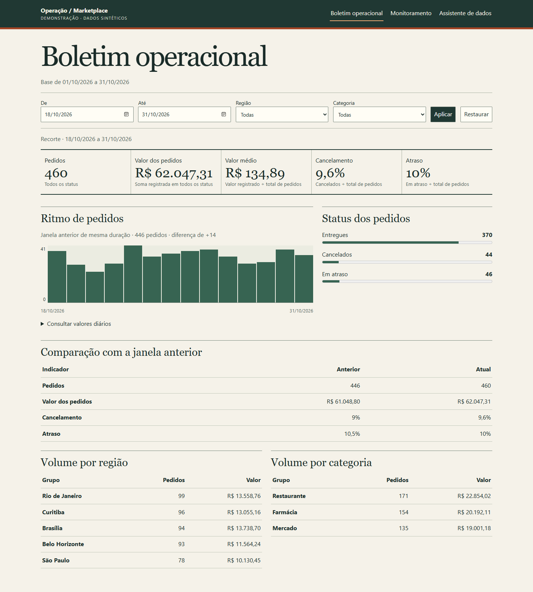
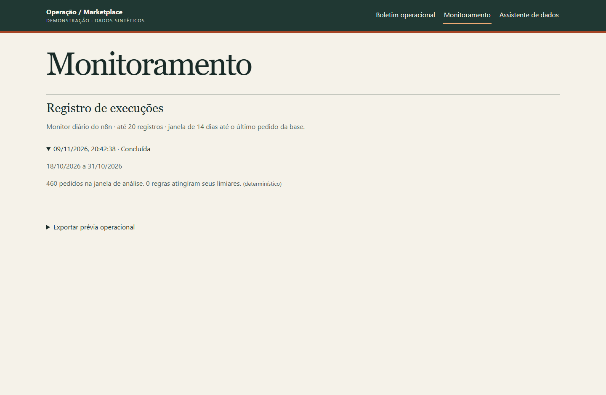

# Agente de Inteligência Operacional

Um marketplace precisa acompanhar o ritmo de pedidos, os cancelamentos e os atrasos por região e categoria. O projeto reúne essas consultas em um boletim operacional e registra o resultado de um monitor diário para revisão posterior.

A demonstração usa **1.000 pedidos sintéticos** de outubro de 2026, distribuídos em cinco regiões e três categorias. Cada pedido tem data, região, categoria, valor e status. A base não contém repasses, pagamentos, margens, prazos prometidos ou datas de entrega. O valor dos pedidos soma todos os status, inclusive cancelados, e a base não permite calcular receita reconhecida.

## Boletim e histórico

A visão inicial mostra os últimos 14 dias até o pedido mais recente. É possível combinar datas, região e categoria. O gráfico mostra a contagem por dia com uma tabela de valores acessível por teclado. Os rankings ordenam regiões e categorias por volume e mostram o valor registrado. A comparação usa a janela imediatamente anterior de igual duração, com os mesmos filtros, quando a cobertura inclui as duas janelas.

| Indicador | Definição |
| --- | --- |
| Valor médio | Soma dos valores registrados dividida pelo total de pedidos no recorte |
| Cancelamento | Pedidos com status cancelado divididos pelo total no recorte |
| Atraso | Pedidos com status em atraso divididos pelo total no recorte |
| Status | Distribuição dos pedidos pelo status registrado na base |

Taxas e valor médio ficam indefinidos quando o recorte tem zero pedidos. Dias sem pedidos aparecem como zero dentro da cobertura observada.

[Versão tablet](docs/evidence/boletim-768.png) · [Versão celular](docs/evidence/boletim-390.png)

[Tela do assistente](docs/evidence/assistente.png)

## Arquitetura

~~~mermaid
flowchart LR
  CSV["CSV sintético"] --> ETL["ETL Python"] --> DB[("PostgreSQL")]
  UI["React / Vite"] --> API["FastAPI"]
  N8N["n8n · manual ou agenda"] -->|POST autenticado| API
  API -->|agregações e histórico| DB
  API -->|"Function Calling no chat / resumo opcional no monitor"| GEMINI["Gemini"]
~~~

O ETL valida e atualiza pedidos por identificador. O assistente usa Function Calling com ferramentas SQL autorizadas de leitura. A API preserva os endpoints anteriores e oferece o boletim em GET /operations/dashboard, o histórico em GET /operations/monitor/runs e o disparo autenticado em POST /operations/monitor/run. A exportação JSON da prévia histórica exige aprovação na interface.

## Regras do monitor

O workflow importável chega inativo e tem gatilho manual e agenda de 09h no horário de São Paulo. O n8n chama a API, repete a chamada uma vez em caso de erro e separa relatórios selecionados para prévia de alerta. O backend centraliza as regras e grava o relatório no PostgreSQL.

| Regra | Disparo |
| --- | --- |
| Cancelamento | Taxa ≥ 10%, com pelo menos 30 pedidos na janela |
| Atraso | Taxa ≥ 15%, com pelo menos 30 pedidos na janela |
| Queda de volume | Redução ≥ 30% frente à janela anterior completa, com pelo menos 30 pedidos na janela anterior |

Os limiares são parâmetros da demonstração definidos em [app/monitor.py](app/monitor.py). O monitor usa 14 dias até o último pedido da base. O histórico diferencia a data da execução e o período efetivamente analisado. Há no máximo um sucesso por dia de São Paulo, inclusive se execução manual e agenda coincidirem. Falhas de processamento são registradas quando o banco está disponível. Se o banco estiver indisponível, a falha fica visível no n8n. Uma nova tentativa pode concluir o mesmo dia.

Gemini é opcional no monitor. Com MONITOR_GEMINI_ENABLED=true, MONITOR_GEMINI_MODEL configurado e GEMINI_API_KEY disponível, o backend pede um resumo somente quando há alerta. O modelo recebe contagens e limiares agregados, com tempo limitado, e uma falha aciona o texto determinístico. As regras, contagens e decisões de alerta são calculadas antes dessa etapa.

MONITOR_NOTIFICATION_MODE=preview sinaliza relatórios com alerta no n8n e no painel. O padrão off desativa essa sinalização. O fluxo tem apenas prévia local e não possui integração de envio externo.

## Rodar localmente

1. Copie .env.example para .env. Preencha DB_NAME, DB_USER, DB_PASSWORD, MONITOR_TOKEN e N8N_ENCRYPTION_KEY. Use valores próprios e aleatórios para as credenciais. Configure GEMINI_API_KEY somente para experimentar o assistente ou o resumo opcional.
2. Execute `docker compose up -d --build --wait`. A API inicializa o esquema e carrega o CSV se a tabela de pedidos estiver vazia.
3. Abra o [boletim local](http://127.0.0.1:8080) e o [editor local do n8n](http://127.0.0.1:5678).
4. No editor, importe [n8n/operations-report.json](n8n/operations-report.json). No nó **Gerar e registrar relatório**, escolha uma credencial **Header Auth** com nome de cabeçalho Authorization e valor Bearer seguido de espaço e MONITOR_TOKEN.
5. Rode manualmente duas vezes e confira que o ID da execução persistida é o mesmo. Consulte o histórico na aba **Monitoramento**. A publicação da agenda é uma decisão separada.

Para rodar sem Compose, aplique [etl/schema.sql](etl/schema.sql) ao PostgreSQL, instale requirements-dev.txt, execute `python -m etl.load_orders` e inicie `python -m uvicorn app.main:app --host 127.0.0.1 --port 8000`. Em frontend, use `npm ci` e `npm run dev`. Com n8n no mesmo host, mantenha a URL do workflow.

### Hospedagem futura

O Compose usa volumes para PostgreSQL e n8n. A API escuta no loopback compartilhado pelos serviços e o Nginx expõe apenas as rotas necessárias à interface. PostgreSQL e FastAPI não publicam portas. O boletim e o editor n8n são publicados no loopback do host.

Uma VM remota pode executar o mesmo Compose e permitir acesso administrativo por túnel SSH. Para separar o n8n da API, use conectividade privada e um proxy autenticado dedicado ao disparo, com TLS e revisão das regras de acesso. No n8n Cloud, localhost aponta para a própria instância, então a URL padrão requer essa adaptação. O Compose não inclui essa integração de rede. Uma hospedagem contínua depende de capacidade, volume persistente, backups e da política de suspensão e cotas do provedor. A demonstração não depende de disponibilidade 24h de um plano gratuito.

## Validação

- `python -m pytest -q` · 44 testes aprovados.
- `npm run lint` e `npm run build` em frontend · aprovados.
- Edge com API e PostgreSQL locais em 1440, 768 e 390 px · filtros, navegação, histórico, exportação com aprovação e ausência de rolagem horizontal verificados.
- Integração local com PostgreSQL 17 · 460 pedidos na janela de 18 a 31/10/2026, com 44 cancelados e 46 em atraso. Nenhum limiar atingido. Duas chamadas consecutivas retornaram o mesmo ID.
- [CI](.github/workflows/ci.yml) reproduz testes, build, importação e dupla execução via CLI do n8n em Compose. Consulte o [histórico de Actions](https://github.com/GabrielTIAlef/agente_inteligencia_operacional/actions) para o resultado remoto.

O teste de navegador está em [frontend/tests/demo.mjs](frontend/tests/demo.mjs) e usa Playwright com Edge e a API em execução. Configure PLAYWRIGHT_MODULE se o pacote estiver fora do projeto e DEMO_SCREENSHOTS para gravar as capturas.
