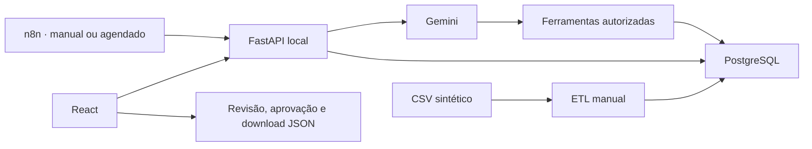

# AI Operations Agent

Painel de operações para um marketplace fictício. O React exibe indicadores do PostgreSQL e oferece um chat com Gemini. O n8n gera uma prévia de relatório a partir da mesma API.

## Arquitetura



- `data/generate_data.py` gera pedidos fictícios. O ETL valida tipos, datas, valores, status e IDs antes de carregar o CSV. A carga faz inserção ou atualização por ID em uma transação. Execute-a deliberadamente em um banco destinado a dados sintéticos.
- A API conserva as rotas de métricas do CSV e do PostgreSQL. `GET /reports/operations` combina quatro indicadores gerais e duas distribuições. As três consultas compartilham uma transação de leitura com uma visão consistente dos pedidos, inclusive durante uma carga simultânea.
- `POST /agent/chat` aceita uma pergunta independente de até 500 caracteres. O Gemini pode escolher apenas as quatro consultas registradas em `app/tools.py`. As conexões abertas pela API usam transações de somente leitura.
- Os logs registram método, rota, status, duração e ID de requisição. Erros do Gemini e chamadas às ferramentas usam o mesmo ID. A API retorna `X-Request-ID` e a prévia inclui o ID no JSON. Perguntas e credenciais ficam fora desses logs.

## Configuração local

Use Python 3.12, PostgreSQL e uma versão do Node compatível com o Vite e o n8n. Em uma instalação nova, copie `.env.example` para `.env` e preencha localmente `DB_HOST`, `DB_PORT`, `DB_NAME`, `DB_USER`, `DB_PASSWORD` e `GEMINI_API_KEY`. `GEMINI_MODEL` escolhe o modelo. `APP_CORS_ORIGINS` aceita uma lista de origens explícitas separadas por vírgula. No frontend, `VITE_API_URL` pode alterar o endereço local da API. Variáveis Vite são públicas.

Em um banco novo e dedicado à demonstração, aplique `etl/schema.sql` pelo cliente PostgreSQL. Rode o ETL explicitamente para carregar a base de exemplo.

```powershell
py -3.12 -m venv .venv
.\.venv\Scripts\python.exe -m pip install -r requirements-dev.txt
.\.venv\Scripts\python.exe -m etl.load_orders
```

Abra dois terminais. Na raiz do projeto, inicie a API em loopback.

```powershell
.\.venv\Scripts\python.exe -m uvicorn app.main:app --host 127.0.0.1 --port 8000 --no-proxy-headers --no-access-log
```

No segundo terminal, inicie o frontend.

```powershell
cd frontend
npm ci
npm run dev -- --host 127.0.0.1 --port 5173 --strictPort
```

Abra [o painel](http://127.0.0.1:5173) e [a documentação da API](http://127.0.0.1:8000/docs).

## Demonstração

1. No dashboard, confira os quatro cartões e os recortes por região e categoria. O valor total é a soma dos pedidos registrados.
2. No chat, pergunte quantos pedidos existem. Compare a resposta com o cartão. Se o provedor estiver indisponível, use o ID mostrado no aviso para localizar o erro nos logs.
3. Em **Automações**, abra o conteúdo da prévia. Marque a aprovação dessa versão e clique em **Baixar relatório JSON**. Atualizar a prévia exige nova aprovação. O download é local e o painel mantém a aprovação na sessão da página.
4. Para demonstrar o n8n, inicie-o na mesma máquina em loopback e importe `n8n/operations-report.json`. Execute pelo gatilho manual e compare `summary.total_pedidos` com o cartão. O `request_id` do nó HTTP aparece no log da API. O agendamento diário está configurado para 09h no horário de São Paulo e depende da publicação do fluxo no próprio n8n.

```powershell
$env:N8N_LISTEN_ADDRESS = '127.0.0.1'
npx --yes n8n@2.46.6 start
```

O fluxo gera uma prévia somente de leitura. O histórico de execução do n8n registra a tentativa. Alterações de pedidos e envio a terceiros exigiriam uma nova integração com aprovação humana autenticada e vinculada à ação.

## Segurança e operação

O modo entregue é uma demonstração de usuário único. A API aceita clientes e cabeçalhos Host locais. A política de origem permite os dois endereços padrão do Vite. O chat exige JSON, limita o corpo a 8 KiB e aceita até 12 tentativas por minuto por processo. A API limita as chamadas ao Gemini por pergunta e as consultas SQL têm prazo de execução. Respostas de erro omitem detalhes de conexão e conteúdo enviado na validação.

Para uma implantação compartilhada, seria preciso implementar identidade e autorização por usuário, HTTPS, limites distribuídos e armazenamento seguro de segredos e logs. Use uma conta PostgreSQL com acesso apenas de leitura para o runtime compartilhado e uma conta separada para o ETL.

## Testes

```powershell
.\.venv\Scripts\python.exe -m pytest -q
cd frontend
npm run lint
npm run build
```

O teste de navegador usa Microsoft Edge, Playwright e as duas aplicações em execução com PostgreSQL. Instale `playwright-core` em um diretório separado e defina `PLAYWRIGHT_MODULE` com a URL de arquivo do módulo `index.mjs` antes de executar `node --test frontend/tests/demo.mjs` da raiz. O teste usa dados do PostgreSQL no painel e simula uma falha do Gemini para verificar a mensagem e a referência exibidas no chat.

Consulte [a documentação do nó HTTP do n8n](https://docs.n8n.io/integrations/builtin/core-nodes/n8n-nodes-base.httprequest/) para configurar a instância de demonstração.
